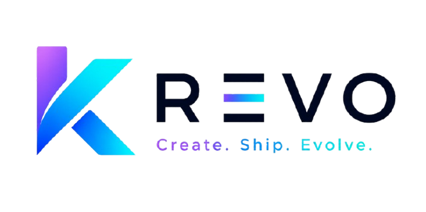

<div align="center">
  

  <h1>ShipSpace</h1>

  <p><strong>A social shipping platform for technical builders.</strong></p>
</div>

ShipSpace, currently branded in deployment as **KREVO**, is a builder-focused social shipping platform for developers, students, makers, indie hackers, and technical teams who want to show real project progress.

Instead of treating a profile as a static resume, ShipSpace turns projects, updates, collaboration, feedback, and reputation into a public builder timeline.

## Current Status

ShipSpace is in **Beta 0.1 / Internal Beta readiness**.

The application code, CI pipeline, Docker image build, and Render-first deployment blueprint are in place. The next release activity is not feature expansion; it is controlled beta deployment and manual acceptance testing.

| Area | Status |
| --- | --- |
| Student/User MVP features | Complete |
| Admin MVP features | Complete for beta operations |
| Backend MVP contract | Frozen for beta |
| Frontend MVP experience | Implemented |
| GitHub Actions CI | Passing |
| Docker image build and push | Passing |
| Render blueprint | Present |
| Manual browser release gates | Pending |
| Public production launch | Not yet |

## Product Capabilities

ShipSpace supports the core beta loop:

- GitHub OAuth login with JWT sessions
- USER and ADMIN role-based access control
- Admin bootstrap through numeric GitHub IDs
- Project creation and public project timelines
- Ship creation for project-linked updates
- Public discovery through trending feeds and search
- Likes, comments, follows, and collaboration requests
- In-app notifications with unread/read state
- ShipScore and rank progression
- Media upload validation before storage handoff
- Banned-user write blocking while preserving reads and logout
- Admin dashboard, user management, ban/unban, reports, audit logs, and moderation views

## Tech Stack

| Layer | Technology |
| --- | --- |
| Backend | Java 17, Spring Boot 3.2 |
| Frontend | React 19, TypeScript, Vite |
| Database | MongoDB 7 |
| Cache/session support | Redis 7 |
| Authentication | GitHub OAuth 2.0, JWT |
| Storage integration | Multibase-compatible upload service placeholder |
| Containerization | Docker, Docker Compose |
| CI/CD | GitHub Actions |
| Beta deployment target | Render free tier plus MongoDB Atlas |

## Architecture

```text
Browser
  |
  | React/Vite frontend
  v
ShipSpace Web
  |
  | REST API calls
  v
Spring Boot API
  |
  +--> MongoDB: users, projects, ships, comments, reports, notifications, audit logs
  |
  +--> Redis: token blacklist, cache, rate limiting support
  |
  +--> GitHub OAuth: identity provider
  |
  +--> Media storage service: validated image upload target
```

The repository is a monorepo:

```text
.
├── src/                         Backend source
├── web/                         React/Vite frontend
├── docs/                        MVP tracking, deployment, and QA runbooks
├── ops/                         Operational scripts and smoke checks
├── observability/               Monitoring configuration
├── .github/workflows/           CI/CD pipeline
├── docker-compose.yml           Local full-stack runtime
├── Dockerfile                   Backend container image
├── render.yaml                  Render beta deployment blueprint
└── pom.xml                      Maven project
```

## Local Development

### Prerequisites

- Java 17
- Node.js 20
- Docker Desktop
- GitHub OAuth App

### Environment

Copy the example files and fill in the required values:

```powershell
copy .env.example .env
copy web\.env.example web\.env
```

Minimum backend values:

```env
MONGODB_URI=mongodb://localhost:27017/shipspace
JWT_SECRET=CHANGE_ME_use_openssl_rand_hex_32
GITHUB_CLIENT_ID=CHANGE_ME
GITHUB_CLIENT_SECRET=CHANGE_ME
GITHUB_REDIRECT_URI=http://localhost:3005/auth/callback
ADMIN_GITHUB_IDS=
CORS_ALLOWED_ORIGINS=http://localhost:3005
```

Minimum frontend values:

```env
VITE_API_BASE_URL=/api
VITE_GITHUB_CLIENT_ID=CHANGE_ME_GITHUB_CLIENT_ID
VITE_GITHUB_REDIRECT_URI=http://localhost:3005/auth/callback
```

`ADMIN_GITHUB_IDS` must contain numeric GitHub IDs, not usernames.

### Run With Docker Compose

This is the recommended local beta runtime.

```powershell
docker compose up --build -d
```

Services:

| Service | URL |
| --- | --- |
| Frontend | `http://localhost:3005` |
| Backend API | `http://localhost:8086/api` |
| MongoDB | `localhost:27017` |
| Redis | `localhost:6380` |

Health checks:

```powershell
Invoke-WebRequest http://localhost:8086/api/actuator/health/liveness
Invoke-WebRequest http://localhost:8086/api/health
```

### Run Frontend Separately

```powershell
cd web
npm ci --legacy-peer-deps
npm run dev
```

### Run Backend Separately

```powershell
.\mvnw.cmd spring-boot:run
```

Standalone backend defaults to port `8080` unless `PORT` is overridden.

## Testing And Verification

Backend compile:

```powershell
.\mvnw.cmd -q -DskipTests compile
```

Frontend checks:

```powershell
cd web
npm.cmd run lint
npm.cmd run build
```

Docker smoke test:

```powershell
powershell -ExecutionPolicy Bypass -File .\ops\mvp-smoke-test.ps1 -SkipBuildChecks
```

GitHub Actions currently runs:

- backend compile
- curated MVP backend regression tests
- embedded Mongo repository slice tests
- MVP ship creation integration test with Mongo service
- frontend lint and build
- OWASP dependency check
- Trivy container scan
- Docker build and push to GHCR

CI artifacts are disabled by default to avoid free-tier storage quota failures. Enable them with repository variable `ENABLE_CI_ARTIFACTS=true`.

CodeQL is opt-in because GitHub code scanning must be enabled for the repository first. Enable it with `ENABLE_CODEQL_SCAN=true` after repository security settings are ready.

Legacy Kubernetes deploy jobs are disabled by default. Enable only when that deployment path exists with `ENABLE_LEGACY_K8S_DEPLOY=true`.

## Deployment

The current beta deployment path is **Render first, AWS later**.

`render.yaml` defines:

- `krevo-web`: static frontend service
- `krevo-api`: Docker backend web service
- `krevo-redis`: Render Key Value service

MongoDB is expected to be external, preferably MongoDB Atlas for beta.

Deployment details are documented in:

- `docs/RENDER_DEPLOYMENT.md`
- `docs/MVP_Manual_QA_Runbook.md`
- `docs/MVP_Tracking_Document.md`

Required Render secrets include:

```env
MONGODB_URI=
GITHUB_CLIENT_ID=
GITHUB_CLIENT_SECRET=
GITHUB_REDIRECT_URI=
ADMIN_GITHUB_IDS=
CORS_ALLOWED_ORIGINS=
MULTIBASE_API_URL=
MULTIBASE_API_KEY=
VITE_GITHUB_CLIENT_ID=
VITE_GITHUB_REDIRECT_URI=
```

Render free tier is acceptable for controlled beta, but expect cold starts and modest performance.

## Manual Beta Gates

Before calling the beta release frozen, complete the manual QA gates:

| Gate | Purpose |
| --- | --- |
| GitHub OAuth | First login, returning login, cancel/failure, logout |
| Admin access | ADMIN can access admin tools; USER cannot |
| Banned-user journey | Reads/logout allowed; writes blocked; unban restores writes |
| Media upload | Valid images pass; invalid/malicious files fail |
| Two-user social loop | Follow, like, comment, collaboration, notifications |
| Responsive QA | Public, authenticated, and admin screens across target widths |

## API Surface

Base local Docker API:

```text
http://localhost:8086/api
```

Primary route groups:

| Group | Examples |
| --- | --- |
| Auth | `/auth/github`, `/auth/me`, `/auth/logout` |
| Users | `/users/{id}`, `/users/me/projects`, `/users/me/ships` |
| Projects | `/projects`, `/projects/{id}` |
| Ships | `/ships`, `/ships/{id}`, `/ships/{id}/comments` |
| Feeds | `/feeds/trending`, `/feeds/following`, `/feeds/personalized` |
| Search | `/search` |
| Notifications | `/notifications`, `/notifications/unread-count` |
| Collaborations | `/collaborations` |
| Admin | `/admin/users`, `/admin/reports`, `/admin/audit-logs` |
| Health | `/health`, `/actuator/health/liveness` |

Anonymous users can access public read and discovery routes. Write routes require authentication. Admin routes require ADMIN role.

## Security And Operational Notes

- Use long random `JWT_SECRET` values in every non-local environment.
- Never commit `.env` or provider secrets.
- Use numeric GitHub IDs for `ADMIN_GITHUB_IDS`.
- Keep Swagger disabled by default outside dev/staging.
- Keep Redis private.
- Use a dedicated MongoDB Atlas beta database.
- Keep CI artifact uploads disabled unless storage quota is available.
- Enable CodeQL only after repository code scanning is configured.
- Media storage must be configured with a real reachable endpoint before upload QA can pass.

## Version Plan

| Version | Scope |
| --- | --- |
| Beta 0.1 | Internal beta: owner/admin validation and manual release gates |
| Beta 0.2 | Controlled beta: 5-10 trusted users, blocker fixes only |
| Beta 0.3 | Stability beta: 20-30 users, logs/performance/moderation review |
| RC 1 | Release candidate: no new features, critical fixes only |
| MVP v1.0 | Public MVP launch with accepted post-MVP debt documented |

## Roadmap

Post-MVP items should not block Beta 0.1:

- R2/S3 media storage replacement or finalized Multibase production setup
- email notifications for high-value collaboration events
- real-time push notifications
- richer analytics
- server-side admin search at larger user counts
- recruiter/team discovery workflows
- AWS deployment path

## License

This project is currently maintained as the ShipSpace/KREVO MVP codebase. Confirm license and distribution terms before public release.

## Maintainer

Primary repository:

```text
https://github.com/SamppurnaTH/ShipeSpace
```

Primary maintainer:

```text
SamppurnaTH
```
