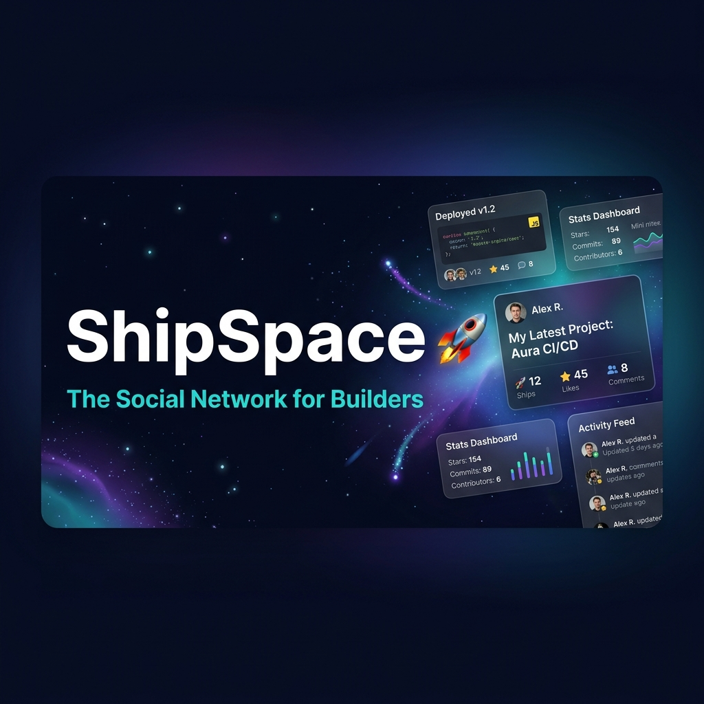

<div align="center">
  

  <br/><br/>

  # 🚀 ShipSpace

  **The Social Network for Builders. Proof of Work > Engagement.**

  <br/>

  
  
  
  
  
  
  
  

  <br/>

  <a href="#-what-is-shipspace">Overview</a> •
  <a href="#-tech-stack">Stack</a> •
  <a href="#-architecture">Architecture</a> •
  <a href="#-features">Features</a> •
  <a href="#-api-reference">API</a> •
  <a href="#-local-setup">Setup</a> •
  <a href="#-roadmap">Roadmap</a>

</div>

---

## 🌐 What is ShipSpace?

ShipSpace is a **social platform built exclusively for technical builders** — indie hackers, side-project developers, and early-stage founders. While Twitter rewards hot takes and LinkedIn celebrates job promotions, ShipSpace rewards one thing: **actually building**.

Every piece of content on ShipSpace is a **Ship** — a project update anchored to a persistent **Project**. This creates a transparent, chronological log of your building journey visible to the whole community.

| Platform | Problem |
|---|---|
| **Twitter/X** | Noise and engagement bait drown out technical signal |
| **LinkedIn** | Corporate signaling over real building progress |
| **GitHub** | Great for code, missing the social discovery layer |
| ✅ **ShipSpace** | Content = project updates. Proof of work, always. |

---

## 🛠 Tech Stack

| Layer | Technology | Purpose |
|---|---|---|
| **Backend API** | Spring Boot 3.2 (Java 17) | Core REST API, business logic |
| **Frontend** | React 19 + TypeScript + Vite | Single-page application |
| **Primary Database** | MongoDB 6+ | Users, ships, projects, notifications |
| **Cache** | Redis 7+ (Lettuce client) | Trending feed, rate limiting, token blacklist |
| **Authentication** | GitHub OAuth 2.0 + JWT (JJWT 0.12.3) | Secure, builder-quality identity |
| **Image Storage** | Multibase (content-addressed) | Immutable media, EXIF-stripped |
| **Reverse Proxy** | Nginx | SSL termination, routing |
| **API Docs** | SpringDoc OpenAPI 3 (Swagger UI) | Dev/staging only |
| **Async Processing** | Spring `@Async` + bounded thread pool | Non-blocking background tasks |
| **Scheduled Jobs** | Spring `@Scheduled` | Score decay, trending recalculation |
| **Containerization** | Docker + Docker Compose | Portable, reproducible deployments |
| **CI/CD** | GitHub Actions | Lint, type-check, automated tests |

---

## 🏗 Architecture

```
┌─────────────────────────────────────────────────────────┐
│                        Client                            │
│              (React 19 + TypeScript + Vite)              │
└──────────────────────────┬──────────────────────────────┘
                           │ HTTPS
                           ▼
┌──────────────────────────────────────────────────────────┐
│                    Nginx (Reverse Proxy)                  │
│              SSL Termination · Load Balancing             │
└──────────────────────────┬───────────────────────────────┘
                           │
                           ▼
┌──────────────────────────────────────────────────────────┐
│               Spring Boot API  (Port 8080)                │
│                                                           │
│  ┌────────────┐  ┌────────────┐  ┌───────────────────┐  │
│  │    Auth    │  │    Feed    │  │    Engagement     │  │
│  │ GitHub OAuth│  │ Following  │  │  Likes · Comments │  │
│  │  JWT Tokens│  │ Trending   │  │  Atomic counters  │  │
│  │            │  │ Personalized│  │                   │  │
│  └────────────┘  └────────────┘  └───────────────────┘  │
│                                                           │
│  ┌────────────┐  ┌────────────┐  ┌───────────────────┐  │
│  │   Social   │  │  Scoring   │  │  Personalization  │  │
│  │ Follow/    │  │ ShipScore  │  │ BehavioralSignal  │  │
│  │ Unfollow   │  │ Levels 1-30│  │ InterestProfile   │  │
│  │ Counters   │  │ Rank Tiers │  │ Hybrid Feed       │  │
│  └────────────┘  └────────────┘  └───────────────────┘  │
│                                                           │
│  Scheduled Jobs:                                          │
│  ├── ScoreDecayJob         @ 02:00 AM daily               │
│  ├── TrendingRecalculation @ every 15 min                 │
│  ├── TimeDecayJob          @ midnight                     │
│  └── CounterReconciliation @ 03:00 AM daily               │
└───────────────┬───────────────────────┬──────────────────┘
                │                       │
                ▼                       ▼
┌──────────────────────┐  ┌────────────────────────────────┐
│   MongoDB (Primary)  │  │    Redis (Cache & Control)     │
│  · Users             │  │  · Trending feed cache         │
│  · Projects          │  │  · Rate limiting (IP-based)    │
│  · Ships             │  │  · JWT token blacklist         │
│  · Notifications     │  │  · User interest profiles      │
│  · Comments          │  └────────────────────────────────┘
└──────────────────────┘
```

---

## ✨ Features

### 🔐 Authentication & Identity
- **GitHub OAuth 2.0** — Builder-quality identity, no email/password noise
- **JWT Access + Refresh Tokens** — Secure, stateless session management
- **Token Blacklist** — Instant revocation on logout via Redis

### 📦 Projects & Ships
- **Project Entity** — Name, one-liner, status (`Idea → Building → Live → Archived`), website/repo URLs
- **Ships (Updates)** — Atomic posts tied to a project (max 500 chars + code snippets + up to 4 images)
- **10-Minute Edit Window** — Ships become immutable historical records after grace period
- **Content-Addressed Image Storage** — EXIF-stripped, deduplication built-in

### 📡 Feeds
| Feed | Description |
|---|---|
| **Following** | Pure reverse-chronological feed from followed builders |
| **Trending** | Engagement-ranked, normalized by follower count + time decay |
| **Personalized** | Hybrid feed using behavioral signals and interest profile matching |

### 🏆 ShipScore Progression System
Gamified reputation system that rewards consistent shipping and meaningful engagement.

| Rank Tier | Levels | How to Earn |
|---|---|---|
| 🔵 **DOCKED** | 1 – 5 | First ships and likes |
| 🟢 **SAILING** | 6 – 10 | Regular shipping cadence |
| 🟡 **NAVIGATOR** | 11 – 15 | High-quality ships with engagement |
| 🟠 **CAPTAIN** | 16 – 20 | Community leader, consistent output |
| 🔴 **COMMODORE** | 21 – 25 | Top-tier builders |
| 🟣 **FLEET_ADMIRAL** | 26 – 30 | Elite. Proof of sustained work. |

### 💬 Engagement
- **Rocket 🚀 Likes** — Atomic `$inc` counters, toggle semantics
- **Threaded Comments** — Max depth 3, with comment upvotes
- **Notifications** — Real-time alerts for likes, follows, comments

### ⚙️ Operations
- **Rate Limiting** — Auth endpoints: 10 req/min per IP (Redis-backed)
- **Auto-Index Init** — Idempotent `MongoConfig.initIndexes()` on startup
- **Score Decay** — Prevents stale content from dominating feeds

---

## 📡 API Reference

> **Base URL:** `http://localhost:8080/api`  
> **Auth:** Bearer JWT token in `Authorization` header

### Authentication

| Method | Endpoint | Auth | Description |
|--------|----------|:----:|-------------|
| `POST` | `/auth/github` | — | GitHub OAuth login / register |
| `POST` | `/auth/refresh` | — | Refresh access token |
| `GET` | `/auth/me` | ✅ | Get current user profile |
| `POST` | `/auth/logout` | ✅ | Revoke tokens |

### Users

| Method | Endpoint | Auth | Description |
|--------|----------|:----:|-------------|
| `GET` | `/users/{id}` | — | Public profile |
| `PUT` | `/users/me` | ✅ | Update own profile |
| `GET` | `/users/me/projects` | ✅ | List my projects |
| `GET` | `/users/me/activity` | ✅ | My activity timeline |

### Projects

| Method | Endpoint | Auth | Description |
|--------|----------|:----:|-------------|
| `POST` | `/projects` | ✅ | Create a project |
| `GET` | `/projects/{id}` | — | Get project details |
| `PUT` | `/projects/{id}` | ✅ | Update project |
| `DELETE` | `/projects/{id}` | ✅ | Delete project + all ships |
| `GET` | `/projects/{id}/ships` | — | All ships for a project |

### Ships

| Method | Endpoint | Auth | Description |
|--------|----------|:----:|-------------|
| `POST` | `/ships` | ✅ | Publish a ship |
| `GET` | `/ships/{id}` | — | Get ship details |
| `PUT` | `/ships/{id}` | ✅ | Edit ship (10-min window) |
| `DELETE` | `/ships/{id}` | ✅ | Delete ship |
| `POST` | `/ships/{id}/images` | ✅ | Upload images |
| `POST` | `/ships/{id}/like` | ✅ | Toggle like (🚀) |
| `POST` | `/ships/{id}/comments` | ✅ | Add comment |
| `GET` | `/ships/{id}/comments` | — | Get comments |
| `DELETE` | `/ships/comments/{id}` | ✅ | Delete comment |

### Feeds

| Method | Endpoint | Auth | Description |
|--------|----------|:----:|-------------|
| `GET` | `/feeds/following` | ✅ | Chronological following feed |
| `GET` | `/feeds/trending` | — | Global trending feed |
| `GET` | `/feeds/trending/{window}` | — | Trending by window: `24h` / `7d` / `30d` |
| `GET` | `/feeds/personalized` | ✅ | AI-hybrid personalized feed |

### Notifications

| Method | Endpoint | Auth | Description |
|--------|----------|:----:|-------------|
| `GET` | `/notifications` | ✅ | All notifications |
| `GET` | `/notifications/unread-count` | ✅ | Unread count |
| `PUT` | `/notifications/{id}/read` | ✅ | Mark single as read |
| `PUT` | `/notifications/read-all` | ✅ | Mark all as read |

### System

| Method | Endpoint | Auth | Description |
|--------|----------|:----:|-------------|
| `GET` | `/health` | — | Health check |

---

## 🚀 Local Setup

### Prerequisites

| Requirement | Version |
|---|---|
| Java | 17+ |
| Maven | 3.6+ |
| MongoDB | 6+ (standalone or replica set) |
| Redis | 7+ |
| Node.js | 18+ (for frontend) |

### 1. Clone & Configure

```bash
git clone https://github.com/SamppurnaTH/ShipSpace.git
cd ShipSpace
cp .env.example .env
```

Edit `.env` with your credentials:

```env
# Database
MONGODB_URI=mongodb://localhost:27017/shipspace
REDIS_HOST=localhost
REDIS_PORT=6379

# Auth — JWT
JWT_SECRET=<min-256-bit-secret>
JWT_EXPIRATION=86400000
JWT_REFRESH_EXPIRATION=604800000

# Auth — GitHub OAuth App
GITHUB_CLIENT_ID=<your-github-oauth-app-client-id>
GITHUB_CLIENT_SECRET=<your-github-oauth-app-client-secret>
GITHUB_REDIRECT_URI=http://localhost:3000/auth/callback

# CORS
CORS_ALLOWED_ORIGINS=http://localhost:3000
```

> 💡 Create a GitHub OAuth App at [github.com/settings/developers](https://github.com/settings/developers). Set the callback URL to `http://localhost:3000/auth/callback`.

### 2. Run the Backend

```bash
mvn spring-boot:run
```

Verify: `curl http://localhost:8080/api/health`

### 3. Run the Frontend

```bash
cd web
cp .env.example .env     # set VITE_API_BASE_URL=http://localhost:8080
npm install
npm run dev              # http://localhost:3000
```

### 4. Docker (All-in-One)

```bash
docker-compose up
```

Services started: `shipspace-api`, `mongodb`, `redis`, `nginx`

For full observability stack (Prometheus + Grafana):

```bash
docker-compose -f docker-compose.observability.yml up
```

---

## 🔒 Production Notes

| Topic | Detail |
|---|---|
| **MongoDB Transactions** | `@Transactional` requires a **replica set**. Annotations are silently ignored on standalone instances. |
| **Index Management** | Auto-index creation is **disabled**. Indexes are applied idempotently via `MongoConfig.initIndexes()` on startup. |
| **Rate Limiting** | Auth endpoints rate-limited at 10 req/min per IP. Requires Redis. |
| **Swagger UI** | Disabled by default. Enable with `SWAGGER_ENABLED=true` in dev/staging only. |
| **Score Decay** | Runs daily at 2:00 AM. Requires `@EnableScheduling` (already enabled). |
| **Trending** | Recalculated every 15 minutes. Tune via `feed.trending.recalculation-interval-ms`. |
| **Media Security** | All uploaded images are EXIF-stripped. Served via signed URLs. |
| **Branch Strategy** | `main` → Production · `develop` → Staging |

---

## 📁 Project Structure

```
ShipSpace/
├── src/
│   └── main/
│       ├── java/com/shipspace/
│       │   ├── ShipSpaceApplication.java   ← Entry point
│       │   ├── config/                     ← MongoDB, Redis, security, async config
│       │   ├── controller/                 ← REST controllers
│       │   ├── service/                    ← Business logic
│       │   ├── repository/                 ← MongoDB repositories
│       │   ├── model/                      ← Domain entities
│       │   ├── dto/                        ← Request/response DTOs
│       │   ├── security/                   ← JWT filter, OAuth handler
│       │   ├── exception/                  ← Global exception handling
│       │   └── util/                       ← Shared utilities
│       └── resources/
│           └── application.yml
├── web/                                    ← React 19 + TypeScript + Vite frontend
│   ├── src/
│   ├── public/
│   ├── vite.config.ts
│   └── package.json
├── docs/
│   └── ShipSpace_Master_Documentation.md
├── .github/
│   └── workflows/                          ← CI/CD pipelines
├── assets/
│   └── hero_banner.png
├── nginx.conf                              ← Production reverse proxy config
├── docker-compose.yml
├── docker-compose.observability.yml        ← Prometheus + Grafana stack
├── Dockerfile
└── pom.xml
```

---

## 🗺 Roadmap

### ✅ Phase 1 — MVP: Core Ship Loop
- [x] GitHub OAuth authentication
- [x] Project & Ship CRUD
- [x] Following + Trending feeds
- [x] Likes, comments, notifications
- [x] ShipScore gamification (Levels 1–30)
- [x] Docker deployment

### 🔄 Phase 2 — Beta: Retention
- [ ] Personalized hybrid feed (85% complete)
- [ ] Weekly digest emails
- [ ] Builder collaboration tools
- [ ] Mobile-responsive frontend polish

### 🔮 Phase 3 — v1.0: Trust
- [ ] Verified milestones via GitHub API
- [ ] Stripe integration for revenue milestones
- [ ] Analytics dashboard for builders
- [ ] Public API for third-party integrations

---

## 📊 Success Metrics

| Metric | Target |
|---|---|
| **WASB** (Weekly Active Shipping Builders) | ≥ 25 at Phase 1 launch |
| **Project Update Frequency** | ≥ 1.5 ships/builder/week |
| **Feedback Velocity** | ≥ 3 meaningful comments/ship within 48h |
| **4-Week Builder Retention** | ≥ 25% |
| **Signal-to-Noise Ratio** | ≥ 80% project-linked content |

---

## 👥 Contributors

<table>
  <tr>
    <td align="center">
      <a href="https://github.com/SamppurnaTH">
        <br/>
        <sub><b>Venu Thota</b></sub>
      </a>
    </td>
    <td align="center">
      <a href="https://github.com/KumarMannepalli">
        <br/>
        <sub><b>Kumar Mannepalli</b></sub>
      </a>
    </td>
  </tr>
</table>

---

## ⚠️ Disclaimer

ShipSpace is an independent open-source project. It is not affiliated with, endorsed by, or connected to any existing platform or company. All trademarks belong to their respective owners.

---

<div align="center">

**Built by builders, for builders.** 🚀

*If you're shipping, you belong here.*

</div>
